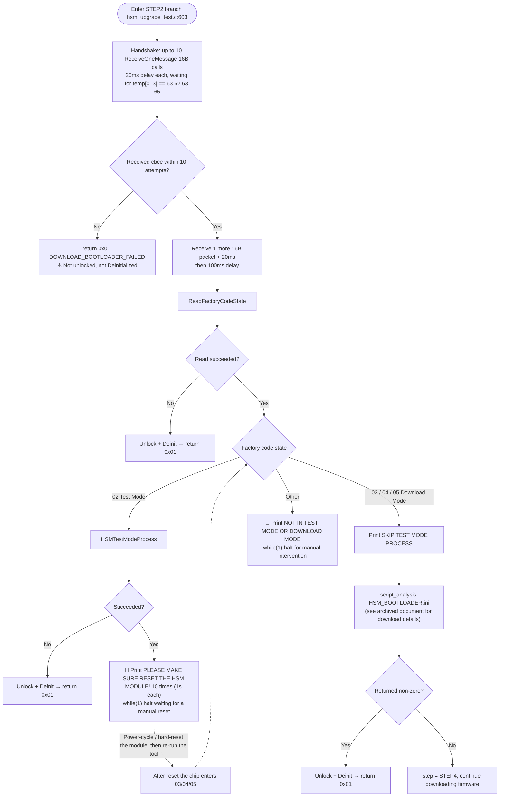
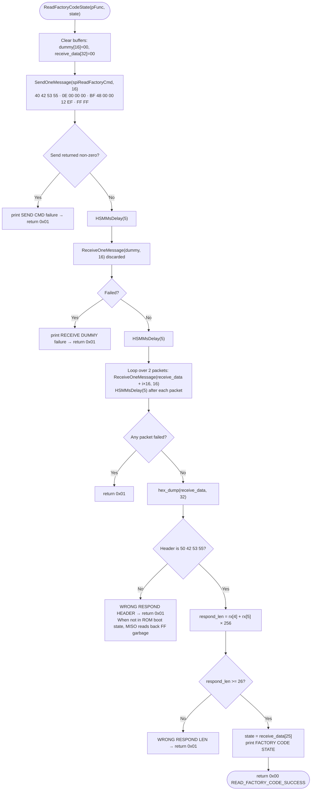
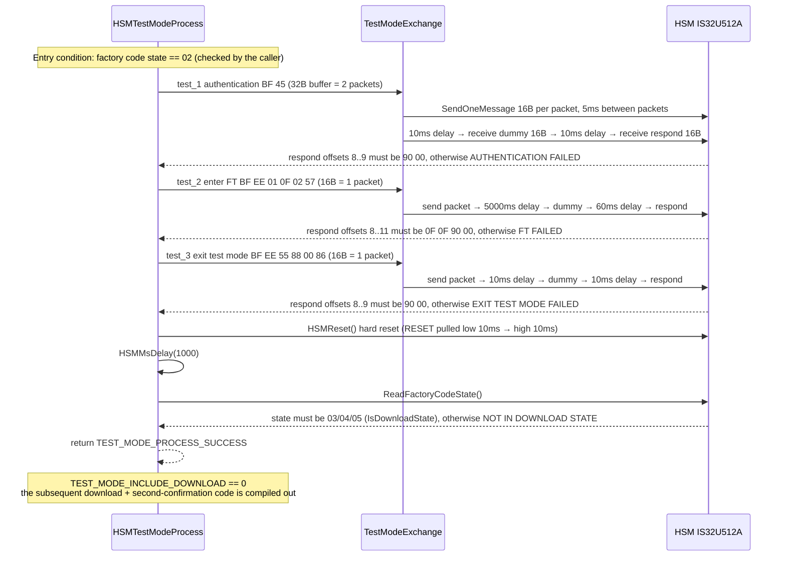

# HSMUpgradeTest · Test Mode (State 02) Download Flow

> Covers only the **test-mode handling branch before STEP2 (downloading the bootloader)** in the upgrade flow,
> i.e. the segment in `hsm_upgrade_test.c`: `ReadFactoryCodeState()` → `HSMTestModeProcess()` → hard reset → halt-and-wait → re-run → download bootloader.

---

## 1. Position: Where Test-Mode Handling Sits in the Overall Flow

Test-mode handling **runs only inside the `step == STEP2_DOWNLOAD_BOOTLOADER` branch** (at this point the chip has neither bootloader nor trusted firmware).
It is a **state gate** before downloading `HSM_BOOTLOADER.ini`: only states `03/04/05` (download mode) are allowed to proceed with the bootloader download.

| Factory Code State        | Meaning                    | Handling                                                                        |
| ------------------------- | -------------------------- | ------------------------------------------------------------------------------- |
| `02`                      | Test Mode                  | Follow the test-mode flow described in this document; a **hard reset** is required to transition to download mode |
| `03` / `04` / `05`        | Download Mode              | Skip the test-mode flow and download the bootloader directly                    |
| Other                     | Unknown                    | Print the state and halt in `while(1)` for manual inspection                    |

---

## 2. Overall Test-Mode Download Flowchart

**Key point:** after `HSMTestModeProcess()` succeeds, the tool does **not** automatically continue to download the bootloader.
Instead, the `while(1);` at `hsm_upgrade_test.c:681` blocks the process and requires the operator to manually reset the module and
**run the tool a second time**. On the second run the factory code is already `03/04/05`, so the `SKIP` branch is taken and the download proceeds normally.
The reason: after the test-mode → download-mode transition, the chip must be reset once more before it can enter the Download Mode download protocol.

---

## 3. Sub-flow: `ReadFactoryCodeState()`

`hsm_upgrade_test.c:145`. Reads the factory code (`BF 48`) to obtain the state byte, which decides whether to enter the test-mode flow.

* All timing is based on **fixed delays** (no BUSY polling), unified under `FACTORY_CODE_DELAY_MS = 5`.
* The state byte is always taken from response offset `25` (`FACTORY_CODE_STATE_INDEX`), hence the 32-byte response buffer (two 16B packets).
* The double check on header + length is necessary: when the chip is not in ROM boot state it reads back `FF` garbage data; without validation the garbage would be mistaken for a valid state.

---

## 4. Sub-flow: `HSMTestModeProcess()` (Three Test-Mode Steps + Hard Reset)

`hsm_upgrade_test.c:376`, the counterpart of the MCU-side state-02 branch. If any step fails validation, it returns `TEST_MODE_PROCESS_FAILED`
(equivalent to the MCU-side `ExceptionAndErrorHandler()`).

### The Three Test-Mode Commands

| Command                 | Full frame sent (trailing `FF` pads to a multiple of 16)                        | Buffer size    | Expected response offsets |
| ----------------------- | -------------------------------------------------------------------------------- | -------------- | ------------------------- |
| `test_1` authentication | `40 42 53 55 · 16 00 00 00 · BF 45 02 00 08 34 61 73 18 45 04 57 02 C8 · FF×10` | 32B (2 packets)| `[8..9] == 90 00`         |
| `test_2` enter FT       | `40 42 53 55 · 0E 00 00 00 · BF EE 01 0F 02 57 · FF×2`                           | 16B (1 packet) | `[8..11] == 0F 0F 90 00`  |
| `test_3` exit test mode | `40 42 53 55 · 0E 00 00 00 · BF EE 55 88 00 86 · FF×2`                           | 16B (1 packet) | `[8..9] == 90 00`         |

* Payload validity is 22/14/14 bytes, padded with 10/2/2 `0xFF` bytes respectively — because `SendOneMessage` rounds up to a whole number of 16-byte packets when copying
  (`hsm_logic_level.c:2209`), so the buffer must cover the padded length.

---

## 5. Test-Mode Delay Parameters

| Location                                                            | Macro                                             | Value          | Notes                             |
| ------------------------------------------------------------------- | ------------------------------------------------- | -------------- | --------------------------------- |
| Factory code read: after command / after dummy / after each response packet | `FACTORY_CODE_DELAY_MS`                           | 5 ms           |                                   |
| Inter-packet send gap (all commands)                                 | Hard-coded inside `TestModeExchange`               | 5 ms / packet  |                                   |
| test_1 authentication                                                | `TEST_MODE_DELAY_AFTER_CMD1_MS` / `…_DUMMY1_MS`   | 10 / 10 ms     |                                   |
| test_2 enter FT                                                      | `TEST_MODE_DELAY_AFTER_CMD2_MS` / `…_DUMMY2_MS`   | 5000 / 60 ms   | Longest phase (FT)                |
| test_3 exit test mode                                                | `TEST_MODE_DELAY_AFTER_CMD3_MS` / `…_DUMMY3_MS`   | 10 / 10 ms     |                                   |
| Wait after hard reset                                                | `TEST_MODE_RESET_WAIT_MS`                         | 1000 ms        | After `HSMReset()`                |
| Halt prompt                                                          | Loop 10× `HSMMsDelay(1000)`                       | 10 s           | Followed by `while(1);`           |
| Packet delay (logic layer)                                           | `IS32U512ASendOneMessage` / `ReceiveOneMessage`   | 2 ms / 1 ms per packet | `hsm_logic_level.c:2212 / 2254` |

> Delay calibration note (`hsm_upgrade_test.c:55-58`): the MCU side timed with busy-wait loops (~30 ns per iteration); the Linux side converts these uniformly into fixed ms delays.
> For field adaptation, **only tune these macros**.

---

## 6. Test-Mode Operator Procedure

1. Run the upgrade command normally → prints `FACTORY CODE IS 02, ENTER TEST MODE PROCESS`.
2. Completes test_1 / test_2 / test_3 in order; after `HSMReset()` prints `TEST MODE: HSM ENTERED DOWNLOAD STATE, STATE=xx`.
3. The tool halts at `PLEASE MAKE SURE RESET THE HSM MODLUE!` (`while(1);`) — the bootloader is **not** downloaded at this point.
4. Manually power-cycle or press the reset button to restart the module, then `Ctrl+C` to terminate the halted tool process.
5. Run the same upgrade command again → the factory code is now `03/04/05` → takes `SKIP TEST MODE PROCESS` → downloads the bootloader → continues with the firmware download.

Failure troubleshooting reference:

| Printed Message                                               | Location                     | What to Check                                                                    |
| ------------------------------------------------------------- | ---------------------------- | -------------------------------------------------------------------------------- |
| `READ FACTORY CODE FAILED: WRONG RESPOND HEADER`              | `ReadFactoryCodeState`       | Chip not in ROM boot state / MISO all `FF`: check reset timing, SPI speed (1M–4M recommended), power supply |
| `WRONG RESPOND LEN`                                           | Same as above                | Abnormal response length field — usually a packet-boundary or speed issue         |
| `TEST MODE: AUTHENTICATION FAILED (test_1)`                   | Step 1                       | Authentication data does not match the module                                     |
| `TEST MODE: FT FAILED (test_2)`                               | Step 2                       | FT not passed; first check whether `TEST_MODE_DELAY_AFTER_CMD2_MS` is too short  |
| `TEST MODE: EXIT TEST MODE FAILED (test_3)`                   | Step 3                       | Exit-test-mode command did not take effect                                      |
| `FACTORY CODE IS xx, NOT IN TEST MODE OR DOWNLOAD MODE`       |                              | Unknown state; by design the tool halts in a dead loop — manually confirm the module state |

---

## 7. Related Return Values

The test-mode branch lives only inside STEP2; all failures uniformly return `DOWNLOAD_BOOTLOADER_FAILED`:

| Value | Macro                          | Trigger conditions in this branch                                                                                   | Lock released?                        |
| ----- | ------------------------------ | ------------------------------------------------------------------------------------------------------------------- | ------------------------------------- |
| `0x01` | `DOWNLOAD_BOOTLOADER_FAILED`  | Handshake timeout / factory code read failure / test-mode flow failure / bootloader download failure                | ⚠ Not released on the handshake-timeout path |
| `0x00` | `UPGRADE_SUCCESS`              | Determined by the subsequent STEP4                                                                                   | ✅                                    |

Internal function return values: `ReadFactoryCodeState` → `0x00 READ_FACTORY_CODE_SUCCESS` / `0x01 READ_FACTORY_CODE_FAILED`;
`HSMTestModeProcess`, `TestModeExchange` → `0x00 TEST_MODE_PROCESS_SUCCESS` / `0x01 TEST_MODE_PROCESS_FAILED`.
