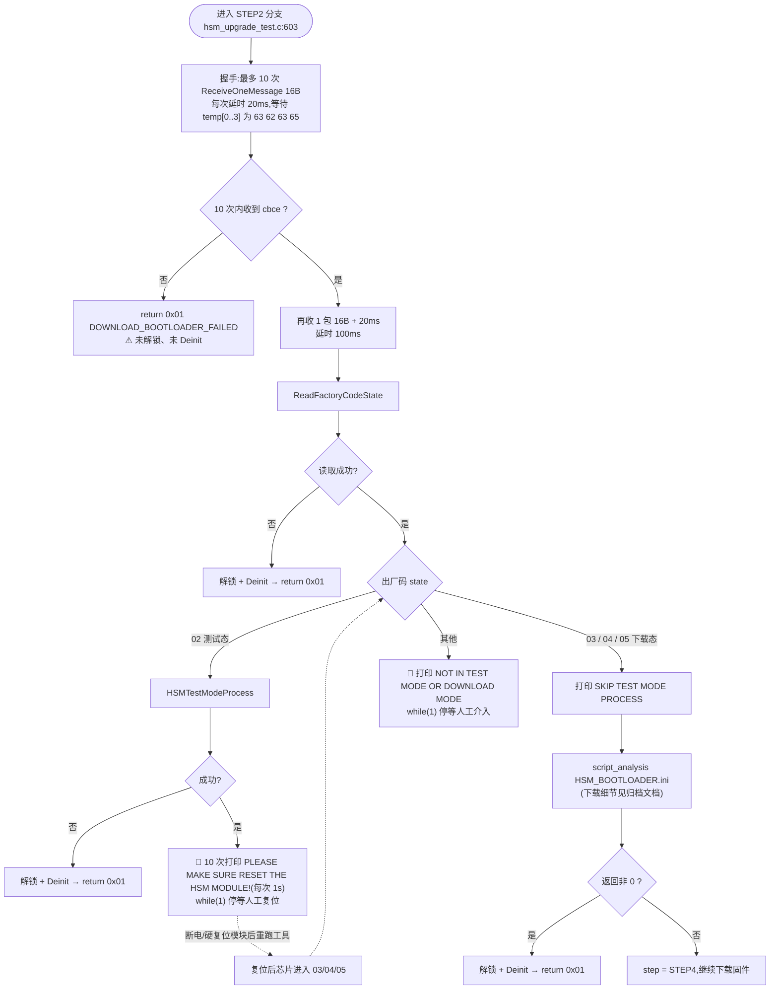
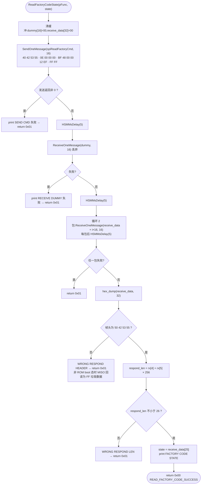
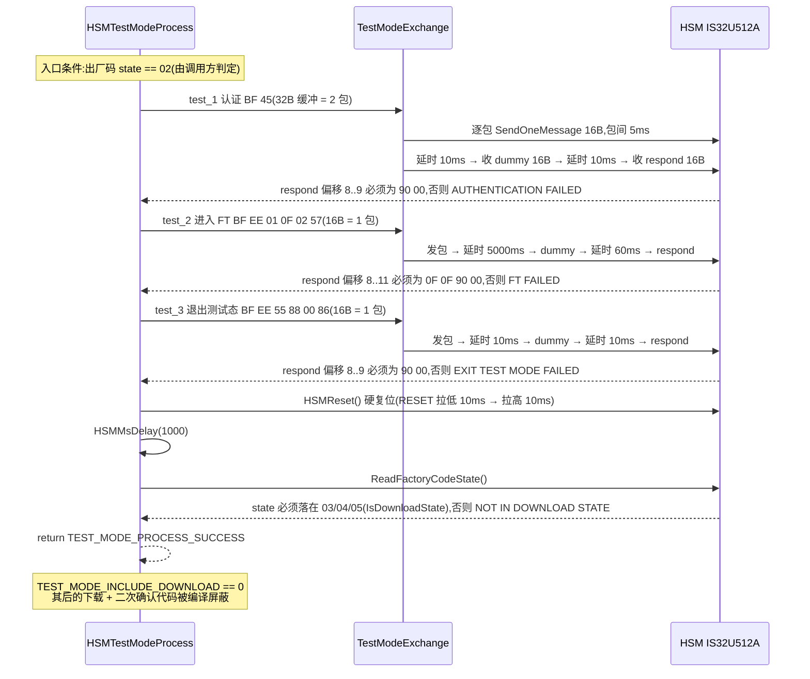

# HSMUpgradeTest · 测试态(02 态)下载流程

> 只覆盖升级流程中 **STEP2 下载 bootloader 之前的测试态处理分支**,即 `hsm_upgrade_test.c` 里
> `ReadFactoryCodeState()` → `HSMTestModeProcess()` → 硬复位 → 停等 → 重跑 → 下载 bootloader 这一段。

---

## 1. 定位:测试态处理在整体流程中的位置

测试态处理**只在 `step == STEP2_DOWNLOAD_BOOTLOADER` 分支里执行**(此时芯片里既没有 bootloader 也没有可信固件),
是下载 `HSM_BOOTLOADER.ini` 之前的**状态闸门**:只有拿到下载态 `03/04/05` 才允许继续下载 bootloader。

| 出厂码状态              | 含义                 | 处理                        |
| ------------------ | ------------------ | ------------------------- |
| `02`               | 测试态(Test Mode)     | 走本文的测试态流程,需**硬复位**才能转成下载态 |
| `03` / `04` / `05` | 下载态(Download Mode) | 跳过测试态流程,直接下载 bootloader   |
| 其他                 | 未知                 | 打印状态并 `while(1)` 停等,人工排查  |

---

## 2. 测试态下载总流程图

**关键点:** `HSMTestModeProcess()` 成功后**不会自动接着下载 bootloader**,而是 `hsm_upgrade_test.c:681` 的
`while(1);` 把进程挂住,要求操作者手动复位模块后**再跑一次工具**。第二次运行时出厂码已经是 `03/04/05`,
于是走 `SKIP` 分支正常下载。原因是测试态→下载态的转换之后必须让芯片重新复位一次才能进入 Download Mode 的下载协议。

---

## 3. 子流程:`ReadFactoryCodeState()`

`hsm_upgrade_test.c:145`。读出厂码(`BF 48`)取状态字节,决定是否进入测试态流程。

* 时序全部为**固定延时**(不做 BUSY 等待),统一 `FACTORY_CODE_DELAY_MS = 5`。
* 状态字节固定取响应偏移 `25`(`FACTORY_CODE_STATE_INDEX`),所以响应缓冲开到 32 字节(2 个 16B 包)。
* 帧头 + 长度双重校验是必要的:芯片不在 ROM boot 态时会读回 `FF` 垃圾数据,不校验就会把垃圾当成有效状态。

---

## 4. 子流程:`HSMTestModeProcess()`(02 态三步 + 硬复位)

`hsm_upgrade_test.c:376`,对应 MCU 端 02 态分支。任一步校验失败即返回 `TEST_MODE_PROCESS_FAILED`
(等价 MCU 端的 `ExceptionAndErrorHandler()`)。

### 三条测试态命令

| 命令 | 完整发送帧(末尾 `FF` 为补齐到 16 倍数) | 缓冲长度 | 期望响应偏移 |
|---|---|---|---|
| `test_1` 认证 | `40 42 53 55 · 16 00 00 00 · BF 45 02 00 08 34 61 73 18 45 04 57 02 C8 · FF×10` | 32B(2 包) | `[8..9] == 90 00` |
| `test_2` 进 FT | `40 42 53 55 · 0E 00 00 00 · BF EE 01 0F 02 57 · FF×2` | 16B(1 包) | `[8..11] == 0F 0F 90 00` |
| `test_3` 退出测试态 | `40 42 53 55 · 0E 00 00 00 · BF EE 55 88 00 86 · FF×2` | 16B(1 包) | `[8..9] == 90 00` |

* 有效性 22/14/14 字节,分别补 10/2/2 个 `0xFF` —— 因为 `SendOneMessage` 会按 16 字节向上对齐整包拷贝
  (`hsm_logic_level.c:2209`),缓冲区必须覆盖补齐后的长度。

---

## 5. 测试态相关延时参数

| 位置                         | 宏                                               | 值              | 说明                              |
| -------------------------- | ----------------------------------------------- | -------------- | ------------------------------- |
| 出厂码读:命令后 / dummy 后 / 每响应包后 | `FACTORY_CODE_DELAY_MS`                         | 5 ms           |                                 |
| 包间发送(所有命令)                 | `TestModeExchange` 内硬编码                         | 5 ms / 包       |                                 |
| test_1 认证                  | `TEST_MODE_DELAY_AFTER_CMD1_MS` / `…_DUMMY1_MS` | 10 / 10 ms     |                                 |
| test_2 进 FT                | `TEST_MODE_DELAY_AFTER_CMD2_MS` / `…_DUMMY2_MS` | 5000 / 60 ms   | FT 阶段耗时最长                       |
| test_3 退出测试态               | `TEST_MODE_DELAY_AFTER_CMD3_MS` / `…_DUMMY3_MS` | 10 / 10 ms     |                                 |
| 硬复位后等待                     | `TEST_MODE_RESET_WAIT_MS`                       | 1000 ms        | `HSMReset()` 之后                 |
| 停等提示                       | 循环 10 次 `HSMMsDelay(1000)`                      | 10 s           | 之后 `while(1);`                  |
| 分包延时(逻辑层)                  | `IS32U512ASendOneMessage` / `ReceiveOneMessage` | 2 ms / 1 ms 每包 | `hsm_logic_level.c:2212 / 2254` |

> 延时标定说明(`hsm_upgrade_test.c:55-58`):MCU 端用忙等循环(约 30ns/次)计时,Linux 侧统一换算成 ms 固定延时,
> 现场适配时**只调这些宏**。

---

## 6. 测试态操作流程

1. 正常执行升级命令 → 打印 `FACTORY CODE IS 02, ENTER TEST MODE PROCESS`。
2. 依次完成 test_1 / test_2 / test_3,`HSMReset()` 后打印 `TEST MODE: HSM ENTERED DOWNLOAD STATE, STATE=xx`。
3. 工具停在 `PLEASE MAKE SURE RESET THE HSM MODLUE!`(`while(1);`),此时**不会**下载 bootloader。
4. 手动断电或按复位键重启模块,`Ctrl+C` 结束挂住的工具进程。
5. 再次执行同一条升级命令 → 出厂码已是 `03/04/05` → 走 `SKIP TEST MODE PROCESS` → 下载 bootloader → 继续下载固件。

失败排查对照:

| 打印信息                                                    | 位置                     | 排查方向                                                     |
| ------------------------------------------------------- | ---------------------- | -------------------------------------------------------- |
| `READ FACTORY CODE FAILED: WRONG RESPOND HEADER`        | `ReadFactoryCodeState` | 芯片不在 ROM boot 态 / MISO 全 `FF`:检查复位时序、SPI 速率(建议 1M~4M)、供电 |
| `WRONG RESPOND LEN`                                     | 同上                     | 响应长度字段异常,通常是分包边界或速率问题                                    |
| `TEST MODE: AUTHENTICATION FAILED (test_1)`             | 第 1 步                  | 认证数据与模块不匹配                                               |
| `TEST MODE: FT FAILED (test_2)`                         | 第 2 步                  | FT 未通过,优先看 `TEST_MODE_DELAY_AFTER_CMD2_MS` 是否偏短          |
| `TEST MODE: EXIT TEST MODE FAILED (test_3)`             | 第 3 步                  | 退出测试态命令未生效                                               |
| `FACTORY CODE IS xx, NOT IN TEST MODE OR DOWNLOAD MODE` |                        | 未知状态,工具按设计死循环停等,需人工确认模块状态                                |

---

## 7. 相关返回值

测试态分支只在 STEP2 内,失败统一返回 `DOWNLOAD_BOOTLOADER_FAILED`:

| 值 | 宏 | 本分支触发条件 | 是否释放锁 |
|---|---|---|---|
| `0x01` | `DOWNLOAD_BOOTLOADER_FAILED` | 握手超时 / 出厂码读取失败 / 测试态流程失败 / bootloader 下载失败 | ⚠ 握手超时路径未释放 |
| `0x00` | `UPGRADE_SUCCESS` | 由后续 STEP4 决定 | ✅ |

内部函数返回值:`ReadFactoryCodeState` → `0x00 READ_FACTORY_CODE_SUCCESS` / `0x01 READ_FACTORY_CODE_FAILED`;
`HSMTestModeProcess`、`TestModeExchange` → `0x00 TEST_MODE_PROCESS_SUCCESS` / `0x01 TEST_MODE_PROCESS_FAILED`。
